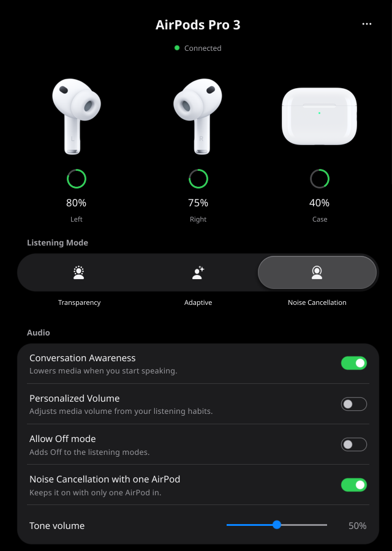
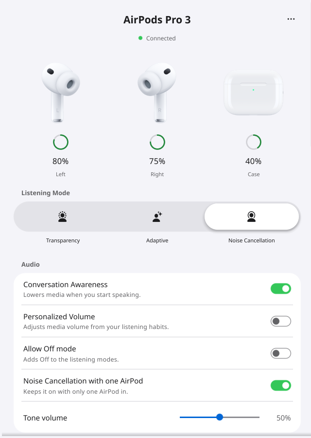
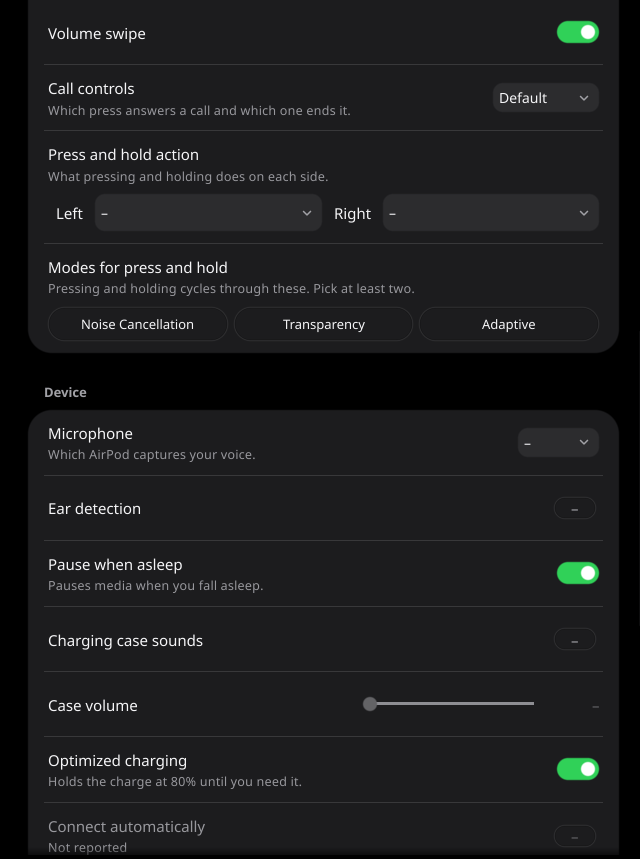
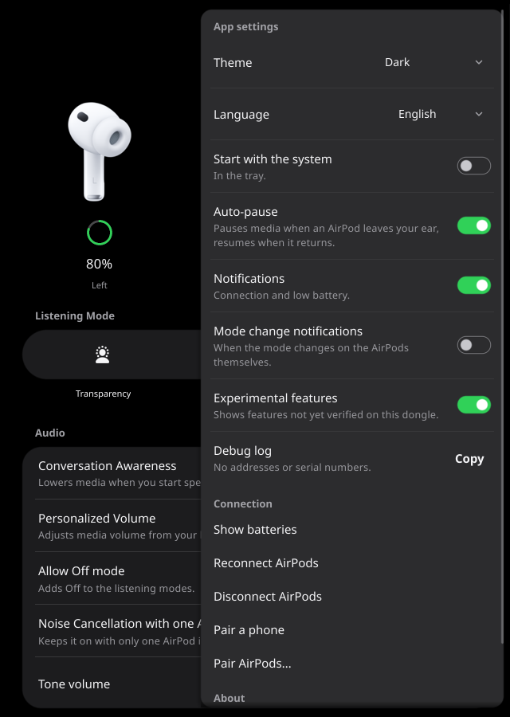

# airpods-gui



A tray app with a settings window, and a command line tool, for the Pico 2 W "AirPods Dongle", for Windows 11 and
Linux. Written in Go, the app with Fyne.

- `airpods-tray` is the tray app and settings window.
- `airpods` is the command line tool. It reads and changes the same settings from a terminal or a script, and
  `airpods diag` captures read-only audio diagnostics as JSON Lines.

The dongle plugs into USB. To your computer it is a normal USB sound device, so the system handles the audio. Both
programs talk to the dongle over USB HID, through the same library in [core/](core/README.md), and show what the AirPods
report: batteries, listening mode and settings. They need no .NET and no kernel driver.

The installer and the packages install both. You can also install the command line tool alone, see
[Download and install](#download-and-install).

**Status: alpha.** See [What has been tested](#what-has-been-tested).

## Features

The app:

- A tray icon that shows the lower earbud battery, and a menu with batteries, listening mode, Disconnect and Reconnect.
- Disconnect that keeps the AirPods paired, on dongle firmware 0.1.59 or newer, and Reconnect that takes them back
  through the same handover and waits until the dongle has them.
- The dongle's reconnect policy, Manual or Automatic, on dongle firmware 0.1.63 or newer.
- A picture and battery reading for each bud and the case, including charging and the age of an old reading.
- Listening mode, with the Adaptive strength on the same control.
- Every AirPods setting your model has, including EN 352 protection (Pro 3) and Gain swipe (Pro 2 and 3) on dongle
  firmware 0.1.64 or newer. A value the AirPods have not reported shows as a dash, never a guess.
- Codec, bitrate and game mode, a nearby finder, pairing and diagnostics: counters, setting report ages, status as JSON
  and a capture to file.
- A choice between several dongles.
- Auto-pause, off by default: pauses your media player when an AirPod leaves your ear, and resumes it when the AirPod
  returns. Dongle firmware 0.1.65 and newer does this by itself, see [Ear detection on the dongle](#ear-detection-on-the-dongle).
- Notifications for connection changes and low battery.
- Light and dark themes, in English, Portuguese, French, Spanish and German.
- An update check, off by default: every two hours it asks GitHub for the newest release, and nothing else. On Windows and
  for the Linux packages it can install the update too; on Linux it asks for your password.
- Optional experimental features, off by default: hearing, hardware checks, Custom Transparency, Loud Sound Reduction
  and EQ, among others. None of these has run on real AirPods yet.

The command line tool does the same from a terminal, except what only a desktop app can do;
[docs/PARITY.md](docs/PARITY.md) compares the two control by control:

- Connection state, codec and batteries, the model, firmware and what the model can do, and every attached dongle.
- Read 25 AirPods settings with the age of each report, and change one and wait for the AirPods to confirm it. Sent,
  confirmed and not confirmed are kept apart, and each has its own output and exit code.
- Connect, reconnect, disconnect while keeping the pairing, pair, and the dongle's reconnect policy.
- Codec, bitrate, game mode, the nearby finder, the performance counters and the dongle firmware version.
- JSON output with a documented schema for scripts, and completion for bash, zsh, fish and PowerShell.
- `airpods diag` captures audio, phone and radio diagnostics to a file.
- Hearing, hardware checks and, behind `--experimental`, Custom Transparency, Loud Sound Reduction, EQ and rename.
  **These have only run against a simulator.**
- `airpods help` works without a dongle. [docs/CLI.md](docs/CLI.md) has every command.

## Ear detection on the dongle

Since dongle firmware 0.1.65 the dongle acts on the AirPods' Ear detection by itself. While USB audio plays, it sends the
computer a Pause media key when an AirPod comes out, and Play when it goes back in, if it made that pause. When
Conversation Awareness starts, it lowers the music it sends to the AirPods. Nothing tells the app whether a dongle does
this, and the dongle has no switch for it: turning the AirPods' **Ear detection** off stops the pause and play, and turning
**Conversation Awareness** off stops the lowering.

That is why the app's own Auto-pause is now off until you turn it on. With both on, the two can act on the same removal.
The app never presses the Play/Pause toggle key, which after the dongle's own pause would start the music again, and on
Windows it now does nothing where the system media controls are not available. If you turned Auto-pause on yourself in an
earlier version, it stays on. See [Auto-pause](docs/USER-GUIDE.md#auto-pause).

## What has been tested

- The app ran against the simulated dongle in a real X11 window. That is where the screenshots come from.
- An older build of the app ran with a real dongle on Arch Linux. Its settings read failed. That is fixed, but the fix
  has not been confirmed on real hardware yet.
- The command line tool, on Linux with a real dongle: `airpods status` and reading settings. Writes (`airpods set`) are
  being tested on a real dongle now. Expect rough edges.
- No real-dongle results are recorded yet for `connect`, `reconnect`, `reconnect-policy`, `pair`, `pair-phone`,
  `disconnect`, `diag`, `list`, `audio`, `game`, `nearby`, `perf`, `connect-automatically`, `allow-auto-connect`,
  `en352-protection` or `gain-swipe`.
- Windows: not run. The exes and the installer are built, but have not been started on real Windows. The installer's
  choice between the app and the command line tool, and its PATH entry, have run under Wine only.
- The Debian packages have been installed over each other and removed in a container, without a dongle.
- The real tray has not been confirmed on any desktop. No Wayland run is recorded.
- The experimental features, `info`, `hearing`, `hardware` and `status --details` have not run on real AirPods. This
  matters most for the hearing features, which change how loud sound is presented.
- `hold-actions` may have left and right swapped.
- The automated tests use a simulated dongle, so passing tests say little about real hardware.

The checks still to do are in the [hardware checklist](docs/BUILD.md#hardware-checklist) and the
[command line checklist](docs/CLI-TESTING.md#hardware-checklist).

## What you need

- A Raspberry Pi Pico 2 W running the [AirPods dongle firmware](https://github.com/Ripthulhu/airpods-dongle). This repo
  has no firmware. Both programs follow firmware 0.1.66 and works with older firmware, with fewer features: Disconnect needs
  0.1.59, the reconnect policy 0.1.63, the newer settings and EQ 0.1.64. Without a dongle the app can only show
  `No dongle`. [NTPods](https://github.com/Ripthulhu/ntpods) describes an experimental Pico 2 W dongle.
- AirPods paired with the dongle. You can start pairing from the app or with `airpods pair`, but that replaces the
  pairing saved on the dongle.
- Windows 11 x64, or Linux x64 with glibc 2.31 or newer and OpenGL. The command line tool alone also runs on Linux
  arm64, and needs neither OpenGL nor a desktop.
- On Linux, a desktop with a tray for the tray icon. Stock GNOME has none. See
  [Tray icon missing on GNOME](docs/TROUBLESHOOTING.md#tray-icon-missing-on-gnome).

## Download and install

Get the files from the [Releases page](https://github.com/Dardrai/airpods-gui/releases). CI builds every file there from
the tagged source, and each release lists their checksums in `SHA256SUMS`. Check your download against it. You can also
[build from source](docs/BUILD.md).

The app and the command line tool, which is what most people want:

| System | File |
|---|---|
| Debian 12 or newer, Ubuntu 22.04 or newer | `airpods-gui_<version>_amd64.deb` |
| Fedora | `airpods-gui_<version>.x86_64.rpm` |
| Arch | `airpods-gui_<version>-x86_64.pkg.tar.zst` |
| Windows 11 x64 | `airpods-gui-<version>-setup-x64.exe` |

The command line tool alone, for a computer with no desktop or an arm64 one:

| System | x64 | arm64 |
|---|---|---|
| Debian, Ubuntu | `airpods-cli_<version>_amd64.deb` | `airpods-cli_<version>_arm64.deb` |
| Fedora and other rpm systems | `airpods-cli_<version>.x86_64.rpm` | `airpods-cli_<version>.aarch64.rpm` |
| Arch | `airpods-cli_<version>-x86_64.pkg.tar.zst` | `airpods-cli_<version>-aarch64.pkg.tar.zst` |
| Windows 11 x64 | the installer above, with the app unticked | |

Plain files, with no installer:

| System | App | Command line tool |
|---|---|---|
| Linux x64 | `airpods-tray-linux-amd64` | `airpods-linux-amd64` |
| Linux arm64 | | `airpods-linux-arm64` |
| Windows 11 x64 | `airpods-tray-windows-amd64.exe` | `airpods-windows-amd64.exe` |

Debian and Ubuntu:

```sh
sudo apt install ./airpods-gui_<version>_amd64.deb
```

Fedora:

```sh
sudo dnf install ./airpods-gui_<version>.x86_64.rpm
```

Arch:

```sh
sudo pacman -U ./airpods-gui_<version>-x86_64.pkg.tar.zst
```

The `airpods-gui` packages install both programs, the launcher, the icons, the udev rule and completions for bash, zsh
and fish, and pull in the libraries the app needs. The `airpods-cli` packages install the command line tool, the udev
rule and the completions, and have no dependencies; install one the same way. A computer has one or the other:
`airpods-gui` replaces `airpods-cli`, because it holds the same command.

Plain Linux binaries:

```sh
chmod +x airpods-tray-linux-amd64 airpods-linux-amd64
sudo mv airpods-tray-linux-amd64 /usr/local/bin/airpods-tray
sudo mv airpods-linux-amd64 /usr/local/bin/airpods
```

The plain app binary needs the libraries listed in [Linux runtime requirements](docs/BUILD.md#linux-runtime-requirements).
Both need the udev rule below.

Windows: run the installer. It installs the app and the command line tool, and puts the tool's folder on your PATH, so
that `airpods` works in a terminal opened afterwards. Untick the app to install the command line tool alone, or untick
the tool to install only the app; `/CLIONLY` and `/NOCLI` do the same for a silent install. It needs no admin rights,
and Windows needs no driver. It has not been run on real Windows yet. Or use the plain exes: keep the app in a folder
where it can stay, because Start with the system remembers its path, and rename the tool to `airpods.exe`. None of
these is signed, so Windows may warn. See [Windows SmartScreen](docs/TROUBLESHOOTING.md#windows-smartscreen).

### Linux: allow access without root

The packages do this for you, but replug the dongle after installing. With a plain binary, run this once in the folder
that holds `70-airpods-hid.rules`, then replug the dongle:

```sh
sudo install -m 644 70-airpods-hid.rules /etc/udev/rules.d/
sudo udevadm control --reload
```

Each release has the rule file. In a clone of this repo it is
[core/hid/70-airpods-hid.rules](core/hid/70-airpods-hid.rules). The rule gives access to the user logged in at the
machine, not to an SSH session; for that, see
[the owner rule](docs/CLI-TROUBLESHOOTING.md#ssh-and-other-sessions-without-seat-access). Windows needs no setup.

## Quick start

1. Plug in the dongle.
2. Start the app. Look for `AirPods` in your app menu, or run `airpods-tray`. The window opens and the tray icon appears.
3. Take the AirPods out of the case. The header changes from `Not connected` to `Connected`.
4. Close the window when you are done. The app stays in the tray. To end it, use Quit in the tray menu.

If something looks wrong, look up the message in [docs/TROUBLESHOOTING.md](docs/TROUBLESHOOTING.md).

To start hidden in the tray, run `airpods-tray --tray`. To print the version, run `airpods-tray --version`. With several
dongles plugged in, choose one in the `...` panel, or start with `airpods-tray --serial SERIAL`.

In a terminal:

```sh
airpods help
airpods list
airpods status
airpods settings
airpods get mode
airpods set mode transparency
```

The app and the command share the dongle's single request channel, so close the tray app if `airpods` reports that the
dongle is busy. See [Sharing the dongle](docs/USER-GUIDE.md#sharing-the-dongle).

## Screenshots

These show a simulated dongle, on a current build.

| Light theme | Settings | The `...` panel |
|---|---|---|
|  |  |  |

## Documentation

| Document | Contents |
|---|---|
| [docs/USER-GUIDE.md](docs/USER-GUIDE.md) | Every part of the window and the tray menu, and what each setting does |
| [docs/TROUBLESHOOTING.md](docs/TROUBLESHOOTING.md) | Every message the app shows, with cause and fix |
| [docs/DISCONNECT.md](docs/DISCONNECT.md) | How Disconnect AirPods releases the AirPods, and what Reconnect does after it |
| [docs/CLI.md](docs/CLI.md) | Every command, setting, exit code and `airpods diag` field |
| [docs/CLI-TROUBLESHOOTING.md](docs/CLI-TROUBLESHOOTING.md) | Every error message of the command line tool, with cause and fix |
| [docs/CLI-DISCONNECT.md](docs/CLI-DISCONNECT.md) | How `airpods disconnect` hands the AirPods over, which firmware it needs, and what is unverified |
| [docs/PARITY.md](docs/PARITY.md) | Every control of the app against its command, every command against its control, and what is left out and why |
| [docs/BUILD.md](docs/BUILD.md) | Building, testing, packages, the installer, CI and the app's hardware checklist |
| [docs/CLI-TESTING.md](docs/CLI-TESTING.md) | The command line tool's goldens and its hardware checklist |
| [core/README.md](core/README.md) | The library both programs use to talk to the dongle, and what it knows about the firmware |

## Layout

| Folder | Contents |
|---|---|
| `core/` | The dongle library: `hid`, `dongle`, `dongle/sim`, `disconnect`, `hearing`, `model`. Pure Go, and the only code that talks to the dongle |
| `cmd/airpods-tray/` | The tray app |
| `cmd/airpods/` | The command line tool |
| `internal/` | What only one of the two needs: the window, tray and desktop integration, and the argument parser |
| `build/` | The build script, the package definitions and the Windows installer |

This repository used to be three: the command line tool was `airpods-cli` and the library `airpods-core`.

## Credits

- [NTPods](https://github.com/Ripthulhu/ntpods): open-source AirPods control for Windows, with an experimental Pico 2 W
  dongle. It inspired this app's layout, and the listening mode icons come by way of it.
- [LibrePods](https://github.com/Ripthulhu/librepods): AirPods features outside Apple's ecosystem. The tray icon is
  drawn from one of its vectors.
- The [AirPods dongle firmware](https://github.com/Ripthulhu/airpods-dongle), whose USB control protocol these programs
  follow. The model notes in [docs/CLI.md](docs/CLI.md) draw on the NTPods model catalog.
- The AirPods pictures belong to Apple. See [internal/ui/assets/README.md](internal/ui/assets/README.md) for where each
  image comes from.

This project is not affiliated with Apple. AirPods is a trademark of Apple Inc.

## License

GPL-3.0. See [LICENSE](LICENSE).
