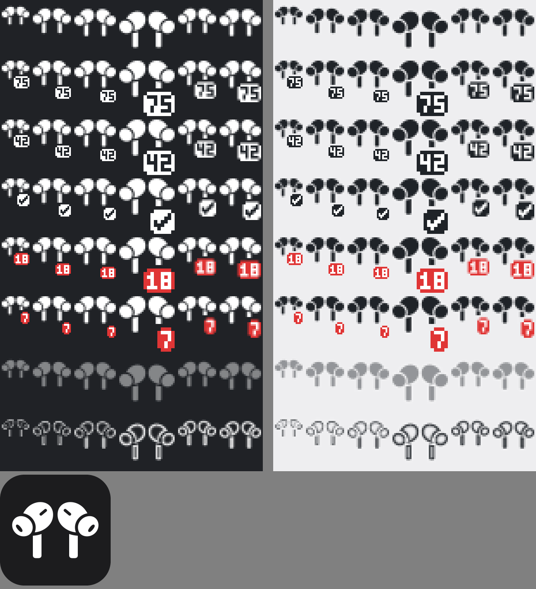
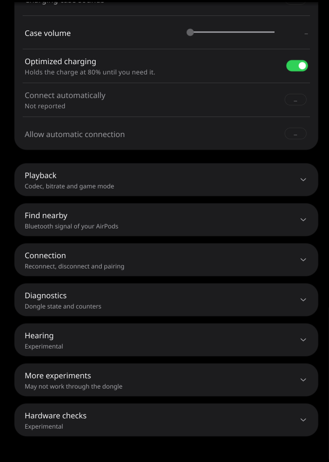
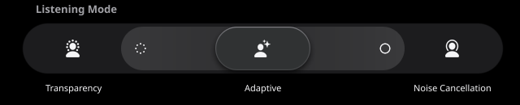
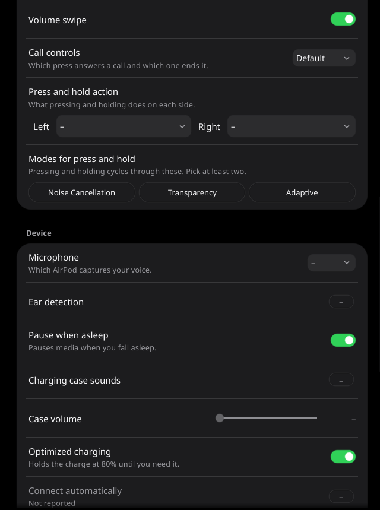
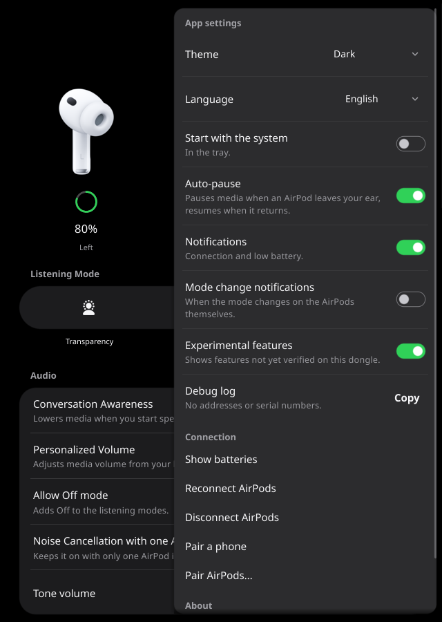
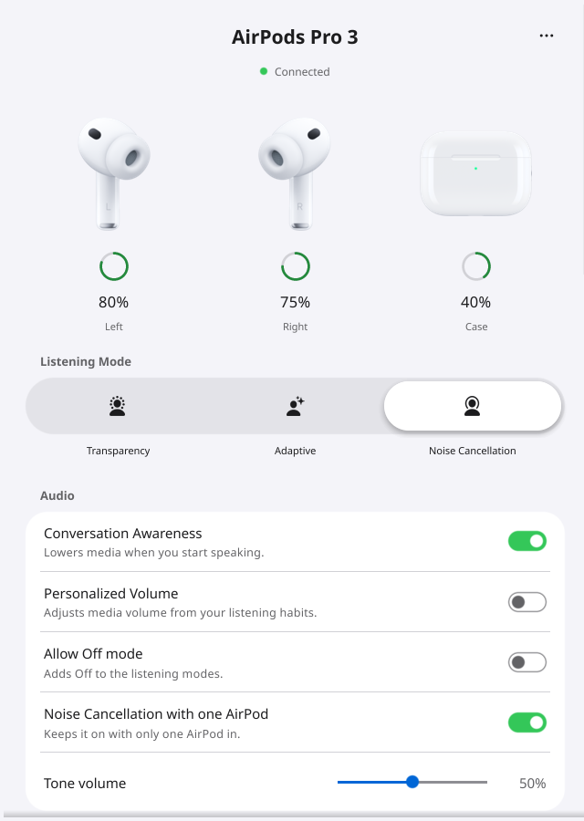

# User guide

This page explains every part of the app, for someone who owns AirPods and a dongle. To install it, see the
[README](../README.md). If you see a message you do not understand, see [TROUBLESHOOTING.md](TROUBLESHOOTING.md).

The app is alpha. See [What has been tested](../README.md#what-has-been-tested). The screenshots show a simulated dongle.

- [How it works](#how-it-works)
- [The tray](#the-tray)
- [The window](#the-window)
- [Header and batteries](#header-and-batteries)
- [Listening mode](#listening-mode)
- [Settings](#settings)
- [Playback](#playback)
- [Find nearby](#find-nearby)
- [Connection](#connection)
- [Diagnostics](#diagnostics)
- [The `...` panel](#the--panel)
- [Experimental sections](#experimental-sections)
- [What the dongle cannot do](#what-the-dongle-cannot-do)
- [Sharing the dongle](#sharing-the-dongle)
- [Starting the app](#starting-the-app)
- [Where your choices are kept](#where-your-choices-are-kept)

## How it works

The AirPods connect to the dongle, and the dongle plugs into your computer over USB. Sound goes through it as normal USB
audio, so your system handles the sound and the volume. This app only controls the dongle. It shows what the AirPods
reported, and it asks the dongle to pass changes on.

Two rules follow from that, and you will see them throughout the app:

- The app never guesses. A value the AirPods have not reported shows as `–`.
- A change is sent once and never repeated by itself. If nothing confirms it, the app says so.

## The tray

### The icon

The icon is a pair of AirPods. It follows your system's light or dark mode.



From top to bottom, the sheet shows:

| Icon | Meaning |
|---|---|
| Plain | The AirPods are connected, with no current earbud reading |
| A number | The lower of the two earbud batteries, in percent. The case does not count |
| A check mark | The lower earbud battery is at 100% |
| A red number | The lower earbud battery is at 20% or below |
| Dimmed | The dongle is plugged in, but the AirPods are not connected |
| Outline | No dongle |

The large picture at the bottom of the sheet is the application icon.

Click the icon to open the window. Hover over it to see the batteries and the mode, where your desktop shows tooltips.

### The menu

The rows, in order:

| Row | What it does | When you can use it |
|---|---|---|
| `AirPods Pro 3 · Connected` | Shows the model and the state. The state can also be `Not connected`, `No dongle` or `Dongle problem` | Never, it is a label |
| `L 80% · R 75% · Case 40%` | Shows the batteries. `80%+` is charging, `80%?` is an old reading, and `--` means no reading | Never, it is a label |
| Off, Noise Cancellation, Transparency, Adaptive | Changes the listening mode. The current one has a check mark. Modes your model lacks are left out | While the AirPods are connected and ready |
| Show batteries | Opens a small window with each battery and the mode. It closes by itself after 6 seconds | While there is any battery reading |
| Disconnect AirPods | Ends the connection and keeps the AirPods paired. See [Disconnect AirPods](#disconnect-airpods) | While the AirPods are connected. With dongle firmware older than 0.1.59, always, to say why it cannot |
| Reconnect AirPods | Takes the AirPods back. See [Reconnect AirPods](#reconnect-airpods) | While a dongle with a saved pair is plugged in, also when the AirPods are away |
| Open settings | Opens the window | Always |
| Quit | Ends the app | Always |

An over-ear model has one battery and no case, so its battery row shows one reading.

If a tray action fails, the reason shows as a system notification, even with notifications turned off.

## The window

There are no tabs. It is one page that you scroll.

Closing the window hides it, and the app keeps running in the tray. Anything the window started stops then, except a
running in-case check. If your desktop has no tray, closing the window ends the app, because you could not get it back
otherwise.

A one-line message can appear at the bottom of the window. That is where the last problem or result shows. For example,
`Reconnect: sent`.

From top to bottom, the page has the header, the listening mode, the Audio, Controls and Device cards, and then sections
that you click to fold open.



## Header and batteries

The header shows the model name, the connection state, and a picture and battery for each bud and the case. Over-ear
models show one picture and one battery. If the model is not known yet, the name is just `AirPods`. The `...` button at the
top right opens [the panel](#the--panel).

The state is one of these:

| Line | Second line | Meaning |
|---|---|---|
| `Connected` | | All is well. The dot is green |
| `Connected` | `Waiting for AirPods` | The AirPods are connected, but not yet ready for settings |
| `Not connected` | `Waiting for AirPods` | The dongle is plugged in, but the AirPods are not connected |
| `No dongle` | `Plug in the AirPods dongle` | The app sees no dongle, and tries again every second |
| `Dongle problem` | The reason | See [TROUBLESHOOTING.md](TROUBLESHOOTING.md#dongle-problem) |

Without a dongle the page shows only the header, since nothing below it could work.

Each battery reads as one of these:

| You see | Meaning |
|---|---|
| `80%` | A current reading |
| `80%` and `Charging` | A current reading, and it is charging |
| `80%`, dimmed, and `3 min ago` | The last reading, and how old it is. It can also say `Under a minute ago` or `2 h ago` |
| `80%`, dimmed, and `Last known` | The last reading, with no known age |
| `–`, dimmed, with a dotted ring | No reading at all. This is common for the case |

A reading counts as current for 30 seconds. A reading that came from the case counts for 90 seconds. A bud that is not
present counts as old. An old percentage can be wrong, which is why it is dimmed.

## Listening mode

The pill shows the modes your model has: Off, Transparency, Adaptive and Noise Cancellation. Click one to switch.

- **Noise Cancellation** reduces outside sound.
- **Transparency** lets outside sound in.
- **Adaptive** blends the two.
- **Off** does neither. On AirPods Pro 2 and Pro 3, Off only shows if [Allow Off mode](#audio) is on. The dongle forgets
  Allow Off whenever the AirPods connect again, and on Pro 3 it refuses Off until Allow Off is sent again. The app sends your
  choice once on each connection, and choosing Off before that sends it first.

Adaptive needs AirPods 4 with ANC, AirPods 5, Pro 2, Pro 3 or Max 2, on AirPods firmware 6 or newer.



### Adaptive strength

With Adaptive selected, the pill opens a lane. Drag the capsule along it to set the strength from 0 to 100%. If the lane is
not open, a Strength slider shows under the pill instead. Which end lets in more sound has not been checked.

Strength can only change once the AirPods have confirmed Adaptive and reported a strength. Until then it says
`Available once Adaptive is confirmed`. The AirPods may not report a new strength back, so you may see
`Sent; not reported back`.

## Settings

The cards show only what your model has. Over-ear models see some different names, shown below in the tables. Before the
AirPods have said what model they are, nothing is hidden. For a model this app does not list, a row appears once the
AirPods report that setting.

### What the values mean

| You see | Meaning |
|---|---|
| A switch, list or slider with a value | What the AirPods last reported, or what you just sent |
| `–` in place of a switch, or as the value of a list or slider | The AirPods have not reported this setting. It does not mean off. The slider's thumb is dimmed for the same reason |
| `Still arriving`, with the row dimmed | The AirPods have just connected and are still sending their settings, one by one. The row fills in by itself |
| `Not reported`, with the row dimmed | The AirPods have not reported this setting, and the app cannot safely change it blind. The line shows on the first such row of each card only |
| `Sent; not reported back` | The dongle took the change, but the AirPods have not reported it. The app remembers this value for the pair where it can |
| `sent` | The change went out and no answer came back. It is never sent again; the next read shows the real value |
| `unknown device value (0x…)` | The AirPods reported a value this app has no word for |

Some `–` rows can be used anyway. Clicking a `–` switch turns the setting on. This works for settings that can be set
without a report to start from: Ear detection, Charging case sounds, and Allow Off mode on Pro 3. The lists and sliders
for Microphone, Volume swipe duration, Case volume, Press and hold action, and Modes for press and hold work the same way.

Settings cannot change while the microphone is in use.



### Models

The model lists in the tables use these names:

- **Pro 2** means both AirPods Pro 2 models. **Max** means AirPods Max with Lightning or USB-C.
- **5 (wireless)** means AirPods 5 with the wireless charging case. **5 (USB-C)** means AirPods 5 with the USB-C case.
- **Powerbeats** means Powerbeats Pro 2.

The lists show what the app offers. Most of these combinations have not been tried on real AirPods, and the dongle or the
AirPods have the last word.

### Audio

| Name | What it does | Models |
|---|---|---|
| Conversation Awareness | Lowers media when you start speaking. Dongle firmware 0.1.65 and newer also lowers the music it sends while it is on | 4 (ANC), 5, Pro 2, Pro 3, Max 2 |
| EN 352 protection | The AirPods' EN 352 hearing protection setting. Needs dongle firmware 0.1.64 or newer, and shows once the AirPods report it | Pro 3 |
| Personalized Volume | Adjusts media volume from your listening habits | 4, 4 (ANC), 5, Pro 2, Pro 3, Max 2 |
| Allow Off mode | Adds Off to the listening modes. Needs AirPods firmware 7 or newer on Pro 2, unless the AirPods report it | Pro 2, Pro 3 |
| Noise Cancellation with one AirPod | Keeps noise cancellation on with only one AirPod in | 4 (ANC), 5, Pro 1, Pro 2, Pro 3 |
| Tone volume | The volume of sounds from the AirPods themselves, such as connection tones. It is not music volume | All except Powerbeats |

### Controls

Over-ear models call this card **Buttons**.

| Name | What it does | Values | Models |
|---|---|---|---|
| Press speed | How much time you get between the presses of a double or triple press | Default, Slower, Slowest | 3, 4, 4 (ANC), 5, Pro 1, Pro 2, Pro 3 |
| Press and hold duration | How long a press and hold takes to register | Default, Slower, Slowest | 3, 4, 4 (ANC), 5, Pro 1, Pro 2, Pro 3 |
| Volume swipe duration | How much time a volume swipe on the stem gets | Default, Longer, Longest | 5 (wireless), Pro 2, Pro 3 |
| Volume swipe | Whether swiping on the stem changes the volume | On, Off | 5 (wireless), Pro 2, Pro 3 |
| Call controls | Which press answers a call and which one ends it. Swapped has not been checked on real AirPods | Default, Swapped | 3, 4, 4 (ANC), 5, Pro 1, Pro 2, Pro 3, Max, Max 2 |
| Press and hold action | What pressing and holding does on each side. Test each stem after a change: left and right may be swapped | Noise control, Siri. Models without listening modes offer only Siri | 3, 4, 4 (ANC), 5, Pro 1, Pro 2, Pro 3 |
| Modes for press and hold | The modes that pressing and holding cycles through. Pick at least two. Over-ear models call this **Modes for the noise control button** | The model's listening modes | 4 (ANC), 5, Pro 1, Pro 2, Pro 3, Max, Max 2 |
| Digital Crown direction | Which way you turn the crown to raise the volume | Default, Reversed | Max, Max 2 |

The Accessibility card also has **Gain swipe**, On or Off, on Pro 2 and Pro 3. Like EN 352 protection it needs dongle
firmware 0.1.64 or newer, and the dongle changes it only once the AirPods have reported it. With older firmware both rows
stay `Not reported`.

### Device

| Name | What it does | Values | Models |
|---|---|---|---|
| Microphone | Which AirPod captures your voice | Auto, Right, Left | 1 to 5, Pro 1, Pro 2, Pro 3 |
| Ear detection | Whether the AirPods notice when you put them in or take them out. Over-ear models call this **Head detection**. With dongle firmware 0.1.65 or newer, it also makes the dongle pause USB playback when a bud comes out and play it again when it goes back in. Turning it off is the only way to stop that | On, Off | All |
| Pause when asleep | Pauses media when you fall asleep. Needs AirPods firmware 8 or newer | On, Off | 4, 4 (ANC), 5, Pro 2, Pro 3, Max 2 |
| Charging case sounds | Whether the case plays sounds | On, Off | 4 (ANC), 5 (wireless), Pro 2, Pro 3 |
| Case volume | The volume of sounds from the case | 0 to 100% | 4 (ANC), 5 (wireless), Pro 2, Pro 3 |
| Optimized charging | Holds the charge at 80% until you need it | On, Off | 3, 4, 4 (ANC), 5, Pro 1, Pro 2, Pro 3, Max, Max 2 |
| Connect automatically | Whether the AirPods connect by themselves. The exact effect through the dongle has not been checked | On, Off | 2 to 5, Pro 1, Pro 2, Pro 3, Max, Max 2 |
| Allow automatic connection | A related setting. The exact effect through the dongle has not been checked | On, Off | Pro 2, Pro 3 |

More about what these settings do, from the command line side, is in the
[command line settings list](CLI.md#settings-1).

## Playback

Shows the codec and bitrate between the dongle and the AirPods, and lets you ask for others. This section needs a dongle
that serves settings. It cannot change while the microphone is in use, or while a change is pending.

| Row | Meaning |
|---|---|
| Active | The codec and bitrate in use now |
| Requested | The codec and bitrate you asked for. It can differ from Active |
| Reported delay | The delay the dongle reports, in ms, or `Not reported` |
| State | `Idle`, `Streaming` or `Change pending`. `, microphone active` is added when the microphone is in use |
| Codec | `Automatic`, SBC, AAC or AAC-ELD |
| Bitrate | `Default`. AAC offers 96 to 220 kbps, and AAC-ELD offers 128 to 256 kbps. Automatic and SBC have no choice |
| Variable bitrate | AAC-ELD only |
| Apply codec and bitrate | Sends the codec, bitrate and variable bitrate together. This can restart the audio link, so sound may drop for a moment |
| Game mode | Turns the dongle's game mode on or off. It can only be used if the dongle supports it |
| Game mode status | What the dongle reports: Off, Waiting for playback (requested, and sent once audio plays), Unconfirmed (sent, not yet confirmed by the AirPods), On, Failed, Unsupported or Turning off. `Not supported` means this dongle has no game mode |

A change that the dongle refused did not apply. A change with no answer shows `sent`, because the link can restart
before the reply arrives; Active and Requested show what really happened.

## Find nearby

Helps you find lost AirPods by their Bluetooth signal. It shows signal strength, not distance. Move slowly and watch the
bar. A closed case can stay quiet for a long time.

Click **Start** to begin and **Stop** to end. It also stops when you fold the section, when the window hides, and when the
app quits.

| Row | Meaning |
|---|---|
| The bar | The signal, in dBm, or `No signal`. A reading older than 10 seconds shows as no signal |
| Finder | `Strong signal` is -60 dBm or more, `Moderate signal` is -80 dBm or more, and `Weak signal` is lower. It can also say what the finder is doing, such as `Paused while audio is playing` |
| Trend | `Getting stronger`, `Getting weaker` or `Steady` |
| Last heard | How long ago the dongle last heard them |

## Connection

These actions are in this section, and in the [`...` panel](#the--panel). Each one is sent once.

| Name | What it does |
|---|---|
| Reconnect AirPods | Takes the AirPods back. See below |
| Reconnect policy | Manual or Automatic. See below |
| Disconnect AirPods | See below |
| Pair a phone | Opens the dongle to a phone, so that a phone can pair with it |
| Pair AirPods | Pairs new AirPods. See the warning below |
| Read settings again | Reads every setting from the dongle again. It rests for 5 seconds after each use, because each read occupies the channel other apps share |

### Reconnect AirPods

On dongle firmware 0.1.59 or newer, Reconnect asks for the AirPods through the routing handover and waits up to 5 seconds
for the dongle to have them. The window shows `Reconnect: connected; the dongle has the AirPods`, or
`Reconnect: taking over; the AirPods are on their way` while the dongle is still connecting. Then the card below About says
`Taking the AirPods over` until they arrive. If the dongle already has them, nothing is sent. Reconnect can take the
AirPods from a phone or computer using them. With older firmware it sends the plain reconnect command and says `sent`.
Reconnect also ends a Disconnect.

### Reconnect policy

Dongle firmware 0.1.63 and newer keep a reconnect policy across restarts:

- **Manual**, the default: the dongle connects to the AirPods only when you click Reconnect or press its button. The
  AirPods can still connect to it by themselves.
- **Automatic**: while the AirPods are not connected and not released, the dongle keeps trying to connect to them by
  itself. That can take them from a phone or another computer using them. A Disconnect then lasts only until the dongle
  restarts or is plugged in again.

The app reads the policy when you open the Connection section, and when you click **Read**. It never reads it with the
status. Choosing Automatic asks first. A change is sent once, and never again by itself:

| Message | Meaning |
|---|---|
| `Saved and verified.` | The dongle saved it and reported it back |
| `Already saved; nothing was sent.` | It was already the policy |
| `Busy: ...` | The dongle saves only while idle: no playback, microphone or call, no connecting, and no app holding a settings session, such as the command line tool. Nothing was saved |
| `Not available: ...` | Dongle firmware older than 0.1.63, or a saved policy it cannot read. It acts as Manual |
| `sent` | The save went out but the dongle could not verify it. Read before you change it. Until the dongle restarts, it can read as not available |

The choice is greyed out during playback and microphone use, and while another request of this app runs.

### Disconnect AirPods

Disconnect AirPods hands the AirPods back: the dongle closes the connection and keeps the pairing. It is also on the page,
below About. It needs dongle firmware 0.1.59 or newer. The window shows `released; the AirPods stay paired`, or
`release accepted, closing the connection` while the dongle is still closing it.

After that the dongle turns the AirPods away until you click **Reconnect AirPods**, a button press ends it, or the dongle
restarts. While they are away, the card below About offers **Reconnect** in place of Disconnect.

Under the Manual reconnect policy the dongle also does not connect to the AirPods by itself after they were away. Click
**Reconnect AirPods**. Without a release, the AirPods can still connect to the dongle on their own. Under the Automatic
policy it reconnects by itself, and a restart of the dongle ends a Disconnect. Once the app has read the policy, the card
says which applies.

With older firmware the item shows a message instead, as a notification and in a dialog, and sends nothing. To disconnect
then, put the AirPods in their case. See [DISCONNECT.md](DISCONNECT.md).

### Pair AirPods

> **Warning:** this replaces the pairing saved on the dongle. The AirPods paired now will have to be paired again to come
> back. Do not use it to disconnect.

Pairing is blocked while USB audio is playing, the microphone is in use, or a phone is connected. Stop those first. If it
is allowed, the app asks you first. Put the AirPods in pairing mode, then click **Replace pairing**.

The dongle can answer busy after it has already dropped the AirPods and erased their pairing, for example while the AirPods
microphone is requested. The app then says so in a dialog and does not send it again. Check the header before you try
again; the AirPods may need pairing again.

## Diagnostics

For checking the dongle, or for a bug report. The values refresh every 3 seconds while the section is open, and **Refresh**
reads them at once.

The first rows are the state in words:

| Row | Meaning |
|---|---|
| Model | The name and model number, `Unknown model (A1234)`, or `Not reported` |
| Firmware | The AirPods' firmware |
| Serial | The AirPods' serial number. It stays `Hidden` until you click **Show** |
| Dongle | `Plugged in`, or `No dongle` |
| Dongle serial | The dongle's USB serial |
| AirPods | `Connected`, with the AirPods' Bluetooth address, or `Not connected` |
| Controls | `Ready`, or `the AirPods aren't ready yet` |
| Batteries | Each battery in words, such as `Left 80% (charging)`, `Case 40% (45 s old)` or `Case unknown` |
| Noise control | The current listening mode |
| Codec | The codec in use |
| In use | Any of `streaming`, `USB playback`, `microphone`, `phone connected` and `phone pairing open`, or `Nothing` |

This section shows your AirPods' address and can show their serial, so check a screenshot before you share it.

The counters below come from the dongle. They are mostly useful to whoever looks into a bug:

- **Dongle:** Uptime, Input, Codec, Flags.
- **Audio buffer:** Buffer used, Buffer high water, Underflow frames, Dropped frames. Rising underflow or dropped frames
  can go with audible gaps.
- **Encoder:** Encoded units, Encode time, Encode time max, Send failures, Recoveries.
- **Memory:** Heap capacity, Heap allocated, Heap remaining, Heap arena.

**Setting reports** lists every setting with what the AirPods last reported and how old that report is, in the words of
`airpods settings`, such as `mode: adaptive (report age 900 ms)`. A setting with no report says `not reported`. That does
not mean it is off.

**Copy status as JSON** reads the dongle and puts one JSON document on the clipboard, with the same fields as
`airpods --json status` and `airpods --json settings` of the [command line tool](CLI.md), schema `1`:
`state`, `settings_ready`, `codec`, `batteries` and a `settings` array of `name`, `raw`, `decoded`, `age_ms` and `unknown`.
What was not reported is `null`. Like the section itself, it can hold your AirPods' state, so check it before you share it.

**Copy as JSON** copies one more document, each with the fields of the matching `airpods` command, schema `1`:

| Button | Same as | Note |
|---|---|---|
| Dongle list | `airpods --json list` | Works with no dongle attached |
| Info | `airpods --json info --capabilities` | The serial stays `null`, as it does without `--show-serial` |
| Hearing state | `airpods --json hearing status` | AirPods Pro 2 and Pro 3 |
| Hardware status | `airpods --json hardware status` | AirPods Pro 2 and Pro 3, with the microphone not in use |
| Hardware data | `airpods --json hardware data` | AirPods Pro 2 and Pro 3, with the microphone not in use |
| Custom Transparency | `airpods --json experimental --experimental transparency show` | Needs **Experimental features** and a model that lists it |
| Loud Sound Reduction | `airpods --json experimental --experimental loud-sound-reduction get` | Needs **Experimental features** and a model that lists it |

**Capture to file...** asks for a file, then saves one line of JSON per sample, the same lines as `airpods diag`. It changes
no settings, and the rest of the app keeps working during a capture.

| Option | Adds | `airpods diag` |
|---|---|---|
| Duration | 10 s to 30 min | `--seconds` |
| Audio trace | Timing counters and recent events. On by default. | off with `--no-trace` or `--legacy` |
| Inspect signal | Signal levels and the latest AAC-ELD frame. Renewed every 10 seconds and turned off at the end. | `--inspect` |
| Phone input | Phone queue and decoder counters | `--phone` |
| Radio only | Only radio and adaptive bitrate readings, every two seconds, without the others | `--radio` |

A sample lost because another app holds the channel or the dongle is away leaves a line with `skipped` in the file, and 30
in a row end the capture. **Stop capture** ends it early, and quitting the app does too. Lines already written stay in the file, also if the dongle
goes away. If inspection cannot be turned off, the section says so, and the dongle ends it by itself within 2 minutes. See
[airpods diag's field list](CLI.md#json-lines-fields) for what the fields mean.

## The `...` panel

Click `...` at the top right of the header. Click outside the panel to close it.



### Dongle

Only shown when several dongles are plugged in. The list has the USB serial of each dongle that can be opened, and the app
uses the one you choose, one at a time, and remembers it. Below the list, each other dongle has the reason it cannot be
chosen, such as no permission to open it. The header and the tray's top row then name the dongle in use. The list is
disabled during a hearing change or a capture.

If only one of them can be opened, the app uses that one without asking. If the remembered one is gone and one is left, the
app uses that one and keeps remembering yours. With one dongle plugged in, none of this appears.

### Theme

`Dark`, `Light` or `Follow system`. The default is `Dark`, and the list shows it until you choose another.



### Language

`System`, English, Português, Français, Español or Deutsch. The page and the tray change at once. `System` follows your
desktop's language, and uses English if the app does not have that language. Some messages from deep in the app stay in English.

### Start with the system

Starts the app in the tray when you log in.

- On Windows it adds the value `AirPodsTray` to `HKCU\Software\Microsoft\Windows\CurrentVersion\Run`.
- On Linux it writes `autostart/airpods-tray.desktop` under `$XDG_CONFIG_HOME`, by default `~/.config`.

Both remember where the program is. If you move it, the switch reads as off and the panel says
`The startup entry points to another copy of this app. Turn the option on to repair it.`

### Auto-pause

Off until you turn it on. When an AirPod leaves your ear, the app pauses your media player. When it returns, the app resumes
the player. Resuming counts as "back in" when both buds are in, or when one is in and the other rests in the case.

> **Dongle firmware 0.1.65 and newer do this themselves.** While the AirPods' **Ear detection** is on, the dongle sends a
> Pause media key when a bud comes out during USB playback, and Play when it goes back in. With such a dongle, leave
> Auto-pause off. Nothing tells the app which firmware a dongle runs. To stop the dongle's own pause, turn Ear detection off.

If you turned Auto-pause on yourself in an earlier version, it stays on. If you never changed it, it is now off.

- It only acts while USB audio is playing to the dongle, or while a pause is waiting for the bud to return.
- It only pauses a player that reports it is playing, and resumes only a player it paused that is still paused. After the
  dongle's own pause there is nothing playing, so it leaves the player, and the dongle's Play, alone.
- It does nothing while the microphone is in use, or while a phone owns the audio.
- If you press play yourself, the app leaves the player alone from then on. On Linux the same goes if the player moves to
  another track.
- On Linux it uses MPRIS, which most media players support, and it pauses every player that is playing.
- On Windows it uses the system's media controls and pauses the current session. If those are not available, it does
  nothing. It never presses the Play/Pause media key, which would start the music again after the dongle's own pause.

### Notifications

On by default. System notifications for:

- `Connected` and `Disconnected`. The app waits 3 seconds before it reports a connection and 10 seconds before it reports
  a disconnection, so a short drop stays quiet. It also stays quiet for 20 seconds after it starts and after a dongle is
  plugged in.
- `AirPods battery low`, such as `Left earbud: 18%`. This comes once when an earbud falls to 20%, and again at 10%. The case
  does not count. A level that was already low at the first reading does not notify.

### Mode change notifications

Off by default, and only usable with Notifications on. Tells you when the mode changes on the AirPods themselves, such as
when you press the stem. Changes made in this app do not notify.

### Check for updates

Off by default: until you turn it on, the app never goes online. Turned on, it asks GitHub for the newest release of
this app every two hours, and at startup if that long has passed, with no account and nothing about you, your computer or your AirPods. About then shows
`Up to date.` or `Version … is available.`, and a newer version is announced once with a notification, if
[Notifications](#notifications) are on. **Check now** asks again at once.

On Windows, a copy set up by the installer also shows **Update now**. It downloads the new installer from the release,
checks it against the release's `SHA256SUMS`, and runs it. The app closes, is replaced, and starts again; your settings and
your choice of Start with the system stay. A plain exe started from elsewhere only gets **Release page**.

The same check looks for new dongle firmware at the firmware's own releases. Dongle firmware with the version report
shows its version under About in the `...` panel, and in [Diagnostics](#diagnostics), as **Dongle firmware**; when a newer release is out, About says
`Dongle firmware … is available.` with **Firmware page**, and a notification tells once. Older firmware shows `not reported`,
and About only names the latest release. The app never flashes firmware: download the UF2 from that page and follow
the firmware's own steps.

On Linux, a copy installed from the app's Arch, Debian/Ubuntu or Fedora/openSUSE package also shows **Update now**. It
downloads the matching package, checks it against `SHA256SUMS`, and installs it with your package manager through
`pkexec`, so your desktop asks for your password. Then the app starts again. Closing the password prompt installs
nothing. A plain binary only gets **Release page**.

### Experimental features

Off by default. Shows the [experimental sections](#experimental-sections) for models that have them.

### Debug log

Click **Copy** to put the log on the clipboard. The bottom of the window says `Debug log copied`. Then paste it into a
GitHub issue, along with what you did and what you expected.

The log holds times, connection changes, sizes and result codes. It does not hold addresses or serial numbers. It lives in memory, so copy it before you quit. It starts empty
on each run.

To also print the log to the terminal as it happens, start the app with `AIRPODS_GUI_DEBUG=1`:

```sh
AIRPODS_GUI_DEBUG=1 airpods-tray
```

The Windows build has no console, so use **Copy** there.

To keep the log across runs, start the app with `AIRPODS_GUI_LOG_FILE=1`. It goes to `airpods-tray.log` in
`~/.cache/airpods-tray/` (`%LOCALAPPDATA%\airpods-tray\` on Windows), and older parts move to `.log.1` to `.log.3` at
about 1 MB each. If the app crashes, it writes the log to `crash.log` in the same folder, whether or not this is on.

### Connection and About

The panel repeats the [Connection](#connection) actions and adds **Show batteries**. About shows the version.

**Model catalog** shows what the catalog lists for the reported model: each feature with yes or no, and each control with the
setting that reads it, the same as `airpods info --capabilities`. This is the catalog, not a report from your AirPods, and
firmware can narrow it.

## Experimental sections

> **Warning:** none of these has run on real AirPods yet. They may not work through the dongle. The dongle or the AirPods
> can refuse a request or drop it silently.

Turn them on with **Experimental features** in the `...` panel. Requests in these sections run one at a time, need the
AirPods connected and ready, and stop while the microphone is in use.

### Hearing

For AirPods Pro 2 and Pro 3. It is hidden on other models.

> **Warning:** Hearing Aid and Media Assist change how sound is presented, including how loud it is. They have not been
> verified through this dongle. Read the on-screen warnings before you use them. If a change sounds wrong or too loud, take
> the AirPods out, then turn the mode off here.

Both must first be set up on an iPhone or iPad. This app cannot do that, because setup needs a hearing test. Turning one on
without that setup is refused.

Click **Read** first. It reads the modes and the stored profile, and writes nothing. Until then the switches show `–`, since
an unreported mode is not the same as off.

- **Hearing Aid** and **Media Assist** are switches. Each change is sent once. Turning one on shows a warning and asks first.
  Turning one off asks nothing.
- **Hearing Aid set up** and **Media Assist set up** say `yes`, `no` or `unknown (not reported)`.
- **Report ages** say how long ago the dongle received each report, as of the last read or change. A report older than your
  last change cannot show that change, so compare the ages with the time of the change.
- **Stored hearing profile** appears after a read:
  - The audiogram holds your hearing levels in dB HL, from 0 to 90, for the left (`L`) and right (`R`) ear at each frequency
    from 250 Hz to 8 kHz.
  - **Amplification** (the mean of both ears' gain, -1.5 to 1.5), **Balance** (right minus left, -3 to 3), **Tone** and
    **Conversation Boost** set how the profile is applied. Each ear's gain has to stay between -1.5 and 1.5. A change that
    would go past that is refused, not trimmed: the slider goes back, and the editor says `Not changed: ...`.
  - **Ambient noise reduction** and **Own voice** are what the profile stores. They can be read here, not changed.
  - Nothing is sent until you click **Apply**. Apply stays off until something changed and every audiogram value is valid.
  - Apply lists each change and warns before it sends anything.
  - **Export...** saves what the editor shows to a JSON file. `airpods hearing profile apply --file` takes the same file.
  - **Import...** loads such a file, or all of `airpods --json hearing profile show`, into the editor and sends nothing. What
    the file does not name goes back to what is stored. A file with an unknown field or a value out of range is refused.

Apply needs hearing assistance set up on the AirPods, and leaves Hearing Aid on or off as it was.

If a change gets no answer, the section shows `sent` and a button to turn the mode off, and offers nothing else until you
read again. The offer lasts through a reconnect of the same AirPods.

### More experiments

Shows what your model has.

| Name | What it does | Models | How you know it worked |
|---|---|---|---|
| Custom Transparency | Sets Transparency per ear: amplification (-1 to 2), tone, ambient noise reduction and Conversation Boost. Click **Read**, change it, then **Apply**. The last row shows the ambient noise reduction stored for both ears. While Hearing Aid or Media Assist is on, or not reported off, the editor is greyed out and only turning Custom Transparency off is offered | Pro 1, Pro 2, Pro 3 | `Written and read back.` |
| Loud Sound Reduction | A switch. Click **Read** first. The app looks it up on the AirPods each time | Pro 2, Pro 3 | `Written and read back.` |
| EQ | **EQ on** and Low, Mid and High from 0 to 100, as the AirPods last reported them. Click **Read**, change it, then **Apply**. Needs dongle firmware 0.1.64 or newer | 4, 4 (ANC), 5, Pro 2, Pro 3, Max 2 | `Sent, and reported back by the AirPods.` The AirPods reported exactly the values sent. Anything else says it may have applied, or that nothing was sent |
| Rename | Sets a new name of up to 64 bytes. Click **Send**. The old name may show until the AirPods reconnect | All | You do not. It says `Sent. Its effect is unknown.`, or that the dongle refused it |

### Hardware checks

For AirPods Pro 2 and Pro 3. These are results from the AirPods' own self-check. They are not a medical or repair
diagnosis.

- **Refresh** reads the saved result for each ear, and when it was measured. A result can be `Passed`,
  `Saved result reports a failure`, `Could not reach the test unit`, `No saved result`, or `Stopped:` with a reason such as
  `the lid was opened`.
- **Read device data** shows Hearing test mode, Dosimetry sensitivity and Volume curve. These are raw values. They do not
  establish a sound level.
- **Run check...** starts the in-case check.

The in-case check is only allowed on AirPods Pro 3 (A3063, A3064 or A3065) with firmware 9A348. To run it:

1. Put both AirPods in the case and leave the lid open. Stop all audio, and disconnect any phone.
2. Click **Run check...**, and confirm with **Both are in the open case**.
3. When the app says `Close the case now.`, close it and wait. The AirPods disconnect during the check, which is expected.
4. The app waits up to 2 minutes for new results.

A started check cannot be cancelled. **Stop waiting** only stops the app from watching, and the AirPods may still finish.
Closing the window does not stop the watching. Only **Stop waiting** or quitting does.

## What the dongle cannot do

The app only talks to the dongle, and the dongle decides what reaches the AirPods. Some things are out of reach:

- **Disconnect while staying paired, before firmware 0.1.59.** Older dongle firmware has no such command. Put the AirPods
  in their case instead.
- **Set up hearing assistance.** That needs a hearing test on an iPhone or iPad. The app can only change what is already set
  up.
- **Pass Rename on, or EQ before firmware 0.1.64.** The dongle sends only a fixed list of AirPods requests. Since 0.1.64 EQ
  is on it, but only while the dongle knows the AirPods' model and holds an EQ report from them. The app says so.
- **Confirm Rename.** The AirPods give no answer to it, so nothing can say whether it worked.
- **Tell what its firmware does with Ear detection.** Firmware 0.1.65 and newer pause and play by themselves, and lower the
  music during Conversation Awareness. No report says whether a dongle does this, and only the AirPods' own settings turn it
  off.
- **Promise Custom Transparency or Loud Sound Reduction.** The dongle may refuse them or drop them silently. An error can mean
  that the dongle does not pass them on, not that your AirPods lack the feature.
- **Cancel an in-case check.** There is no command for it.
- **Read every setting.** The AirPods report what they report. The rest stays `–`, and some can be set but not read back.
- **Change the music volume.** The dongle is a USB sound device, so use your system's volume.

## Sharing the dongle

The dongle has one request channel, and it serves one program at a time. The
[`airpods` command](CLI.md) and NTPods use it too. If another program holds it, this app shows
`another app is controlling the dongle`, and the other program may report that it is busy.

Here is when this app uses the channel:

- **Window closed, nothing playing:** it only reads the status report, which does not get in the way, so the CLI can run next
  to the tray. The one exception is a short read each time the AirPods connect, to learn the model.
- **Window open:** it reads settings and other values.
- **When you do something:** each action uses the channel briefly.
- **Auto-pause on, and USB audio playing:** it makes one short request a second to follow your ears. Another program can find
  the channel busy for a moment, and a longer read by another program can be interrupted.

To leave the channel entirely to the CLI, close the window and turn Auto-pause off. If that is not enough, use Quit in the
tray menu.

## Starting the app

| Command | What it does |
|---|---|
| `airpods-tray` | Starts the tray and opens the window |
| `airpods-tray --tray` | Starts hidden in the tray. If no tray appears within 5 seconds, the window opens anyway |
| `airpods-tray --serial SERIAL` | Uses the dongle with this USB serial, and no other, until you choose another in the [Dongle](#dongle) list. It does not change the remembered choice |
| `airpods-tray --version` | Prints the version and exits. The Windows build has no console, so it may print nothing there. The `...` panel shows the version too |

Only one copy runs at a time, so `--serial` has no effect when the app is already running. A second plain start brings up the window of the first and exits. A second start with `--tray`
only exits.

| Environment variable | What it does |
|---|---|
| `AIRPODS_GUI_DEBUG=1` | Also prints the [debug log](#debug-log) to the terminal |
| `AIRPODS_GUI_LOG_FILE=1` | Also keeps the [debug log](#debug-log) in a file |
| `AIRPODS_GUI_SIM=1` | Uses a simulated dongle, to try the app with no hardware. See [Trying the UI without a dongle](BUILD.md#trying-the-ui-without-a-dongle) |

## Where your choices are kept

| What | Linux | Windows |
|---|---|---|
| Theme, language, switches, the chosen dongle's USB serial | `~/.config/fyne/io.github.dardrai.airpods-gui/preferences.json` | `%APPDATA%\fyne\io.github.dardrai.airpods-gui\preferences.json` |
| Values sent to a pair that it does not report back | `~/.config/airpods-tray/` | `%APPDATA%\airpods-tray\` |

Pairs are named in these files by a hash of their Bluetooth address, salted with the random `pair-salt` in the second
folder, so the address itself is not stored. Deleting `pair-salt` leaves what was remembered per pair behind unread.

The AirPods settings themselves are on the AirPods, not in these files. To forget your app choices, quit the app and delete
these files.
